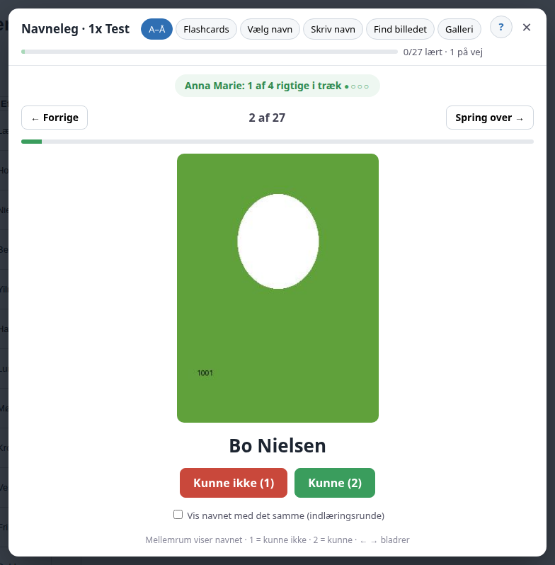
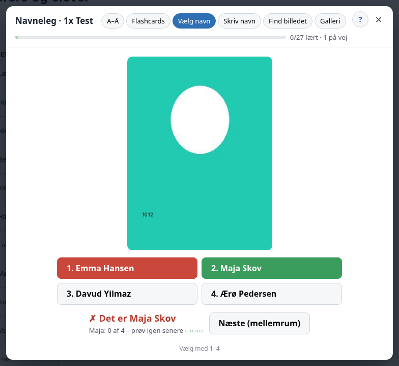
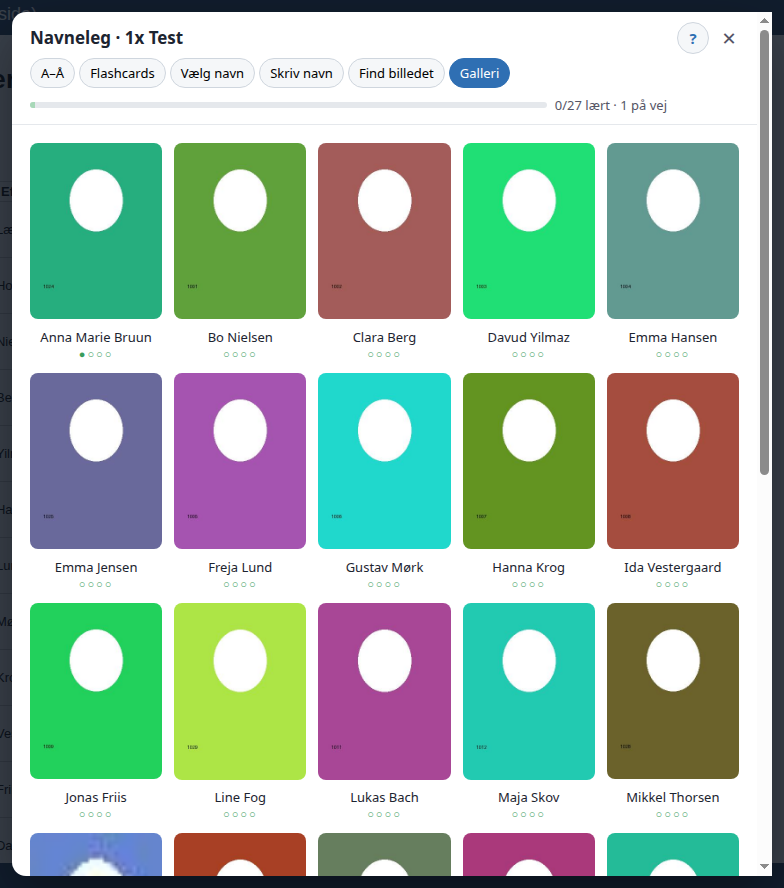

# Navneleg for Lectio

En browserudvidelse, der hjælper lærere med at lære elevernes navne. Den lægger en knap på
Lectios holdside **"Lærere og elever"**. Når du klikker på knappen, kan du øve navnene med
flashcards, quiz og en gennemgang af klasselisten fra A til Å.

Den virker i **Chrome, Edge, Brave, Vivaldi, Opera** og **Firefox**.



> Billederne her i vejledningen er lavet på en opdigtet testside med farvede pladsholdere.
> I Lectio ser du elevernes rigtige billeder.

---

## Indhold
- [Funktioner](#funktioner)
- [Privatliv og GDPR](#privatliv-og-gdpr)
- [Installation](#installation)
  - [Chrome, Edge, Brave, Vivaldi og Opera](#chrome-edge-brave-vivaldi-og-opera)
  - [Firefox](#firefox)
  - [Opdatering til en ny version](#opdatering-til-en-ny-version)
- [Sådan bruger du den](#sådan-bruger-du-den)
- [Fejlfinding](#fejlfinding)
- [For udviklere](#for-udviklere)

---

## Funktioner

| Tilstand | Hvad du gør |
|---|---|
| **A–Å** | Gå hele klasselisten igennem alfabetisk efter fornavn. Til sidst kan du øve dem, du ikke kunne, i en ny runde. Slå "Vis navnet med det samme" til, hvis du bare vil kigge billeder og navne igennem. |
| **Flashcards** | Du ser et billede, tænker på navnet, viser det og siger ærligt, om du kunne det. |
| **Vælg navn** | Vælg det rigtige navn blandt fire. |
| **Skriv navn** | Skriv fornavnet eller hele navnet. Små stavefejl og manglende accenter godkendes. |
| **Find billedet** | Du ser et navn og finder den rigtige elev blandt fire billeder. |
| **Galleri** | Se alle elever og hvor langt du er med hver. |

**Hvornår er et navn lært?** Når du har svaret rigtigt på det **4 gange i træk** (●●●●). Svarer
du forkert, starter det navn forfra. Navne, du ikke kan endnu, bliver vist oftere end dem, du
kan. Efter hvert svar står der kort, hvor langt du er med den elev, f.eks. "Bo: 2 af 4 rigtige i træk".

Elever uden foto og holdets lærere er ikke med.

| Vælg navn | Galleri |
|---|---|
|  |  |

---

## Privatliv og GDPR

Udvidelsen er bygget, så den **ikke gemmer og ikke sender noget om eleverne**.

- Navne og billeder læses direkte fra den Lectio-side, du har åben, mens du er logget ind.
- Dit fremskridt findes kun i browserens hukommelse, mens siden er åben. Du kan lukke og åbne
  quizzen uden at miste det, men det **nulstilles, når du genindlæser siden eller lukker fanen**.
- Det eneste, der gemmes, er et ja/nej for, om du har set hjælpesiden.
- Udvidelsen henter kun elevbilleder fra lectio.dk. Den kontakter ingen andre servere og har
  ingen statistik eller sporing.
- Den kører kun på Lectios side "Lærere og elever" (`…/subnav/members.aspx`).


---

## Installation

Udvidelsen ligger ikke i Chrome Web Store eller på Firefox Add-ons. Du installerer den
selv. Det tager et par minutter.

### Trin 1: Hent udvidelsen

Gå til **[Releases](../../releases/latest)** og hent den fil, der passer til din browser:

- **`navnleg-chrome.zip`** til Chrome, Edge, Brave, Vivaldi og Opera
- **`navnleg-firefox.xpi`** til Firefox

Du kan også hente hele repoet via den grønne knap **Code → Download ZIP**. Udvidelsen ligger så
i mappen `navnleg-extension`.

### Chrome, Edge, Brave, Vivaldi og Opera

1. **Pak zip-filen ud til en mappe, som skal blive liggende**, f.eks. `Dokumenter/Navneleg`.
   Browseren læser udvidelsen fra mappen hver gang, så den må ikke slettes eller flyttes.
2. Åbn siden med udvidelser ved at skrive adressen i adresselinjen:

   | Browser | Adresse |
   |---|---|
   | Chrome | `chrome://extensions` |
   | Edge | `edge://extensions` |
   | Brave | `brave://extensions` |
   | Vivaldi | `vivaldi://extensions` |
   | Opera | `opera://extensions` |

3. Slå **Udviklertilstand** (*Developer mode*) til.
   - Chrome, Brave, Vivaldi og Opera: kontakten sidder øverst til højre.
   - Edge: kontakten sidder i menuen til venstre.
4. Klik **Indlæs upakket** (*Load unpacked*) og vælg den udpakkede mappe. Det er mappen, hvor
   filen `manifest.json` ligger.
5. Udvidelsen **Navneleg for Lectio** står nu på listen. Fastgør den eventuelt via
   puslespilsikonet i værktøjslinjen. Det er ikke nødvendigt, for knappen dukker selv op i Lectio.

> Nogle browsere, især Edge, kan vise en besked om udvidelser i udviklertilstand, når
> browseren starter. Vælg at beholde udvidelsen.

### Firefox

`navnleg-firefox.xpi` er signeret af Mozilla og installeres permanent som en almindelig tilføjelse.

1. Hent **`navnleg-firefox.xpi`** fra [Releases](../../releases/latest) **med Firefox**. Firefox
   spørger så selv, om du vil installere den. Har du hentet filen på anden vis, kan du trække den
   ind i et Firefox-vindue eller åbne `about:addons`, klikke på tandhjulet ⚙ og vælge
   **Installer tilføjelse fra fil…**.
2. Klik **Tilføj**, når Firefox spørger.
3. Udvidelsen **Navneleg for Lectio** står nu under `about:addons`.

**Første gang i Firefox:** Hvis knappen ikke vises på Lectio, skal du give udvidelsen adgang
til siden. Klik på **puslespilsikonet** i værktøjslinjen, find *Navneleg for Lectio* og vælg
**Tillad altid på www.lectio.dk**.

### Opdatering til en ny version

- **Chrome m.fl.:** hent den nye zip-fil, erstat indholdet i din mappe med de nye filer, og klik
  på genindlæs-pilen ↻ ved udvidelsen på udvidelsessiden. Genindlæs derefter Lectio-siden.
- **Firefox:** installer den nye `.xpi` på samme måde som første gang.

### Safari

Safari understøttes ikke.

---

## Sådan bruger du den

1. Log ind på Lectio og åbn et af dine hold.
2. Gå til **Lærere og elever** og vælg visningen **Alm. m/billeder**. Det er siden, hvor du ser
   elevlisten med små billeder.
3. Over tabellen står knappen **🎓 Øv navne (27 elever)**. Klik på den.
4. Første gang vises en kort hjælpeside. Du kan altid åbne den igen med **?** øverst i vinduet.

**Taster**

| Tast | Funktion |
|---|---|
| Mellemrum | Vis navnet / gå til næste |
| 1 / 2 | Kunne ikke / kunne (A–Å og Flashcards) |
| 1–4 | Vælg svar (Vælg navn og Find billedet) |
| Enter | Svar (Skriv navn) / næste |
| ← → | Forrige / næste elev (A–Å) |
| Esc | Luk |

Udvidelsen virker også på tablet og mobil, hvis browseren understøtter udvidelser.

---

## Fejlfinding

| Problem | Løsning |
|---|---|
| Knappen vises ikke | Tjek, at du er på holdets side **Lærere og elever** (adressen indeholder `members.aspx`). Genindlæs siden. I Firefox skal du også give adgang til lectio.dk (se ovenfor). |
| Knappen er grå | Der skal være mindst 2 elever med foto på holdet. |
| Billederne er små eller slørede | Det store billede kunne ikke hentes, så det lille bruges i stedet. Det kan ske, hvis Lectio ændrer noget. |
| Fremskridtet er væk | Det er med vilje. Af hensyn til GDPR gemmes intet, når siden genindlæses eller lukkes. |
| Firefox siger, at tilføjelsen ikke kan bekræftes | Brug `navnleg-firefox.xpi` fra Releases, ikke zip-filen. Kun den signerede `.xpi` kan installeres permanent. |

---

## For udviklere

```
navnleg-extension/   Selve udvidelsen (Manifest V3): manifest.json, content.js, style.css, icons/
build.sh             Bygger dist/navnleg-chrome.zip og dist/navnleg-firefox.zip
                     (Firefox-udgaven får browser_specific_settings i manifestet).
                     Firefox-zip'en signeres på addons.mozilla.org ("On your own")
                     og lægges på Releases som navnleg-firefox.xpi.
test/                End-to-end-test i rigtige browsere
docs/                Billeder til denne vejledning
```

Der er ingen afhængigheder og intet build-trin for selve udvidelsen. `content.js` læser
tabellen `#s_m_Content_Content_laerereleverpanel_alm_gv` og bygger quizzen som et overlay.
Det store billede hentes ved at sætte `&fullsize=1` på thumbnailens `GetImage.aspx`-adresse,
ligesom Lectio selv gør.

### Test

`test/run.sh` kører omkring 100 kontroller i både Chrome og Firefox mod en **helt opdigtet**
Lectio-lignende testside med fiktive elever og billeder. Testen indlæser den rigtige udvidelse,
peger `www.lectio.dk` om til en lokal HTTPS-testserver og styrer browseren via
DevTools Protocol (Chrome) og WebDriver BiDi (Firefox).

Krav: Node 22+, Python 3 med Pillow, openssl, Chrome for Testing (f.eks. fra Playwrights cache)
og Firefox 138+.

```bash
./test/run.sh            # begge browsere
./test/run.sh chrome     # kun Chrome
./test/run.sh firefox    # kun Firefox
CHROME=/sti/til/chrome ./test/run.sh chrome
```

Skærmbilleder fra testen gemmes i `test/shots/`.

> **Commit aldrig en gemt Lectio-side.** Den indeholder rigtige elevdata. `.gitignore`
> udelukker `*Lectio*.html`, men vær opmærksom.

---

Navneleg er et uafhængigt hobbyprojekt og er ikke tilknyttet eller godkendt af MaCom eller Lectio.
